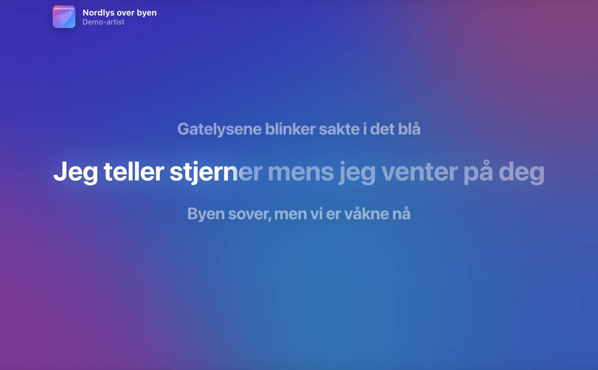
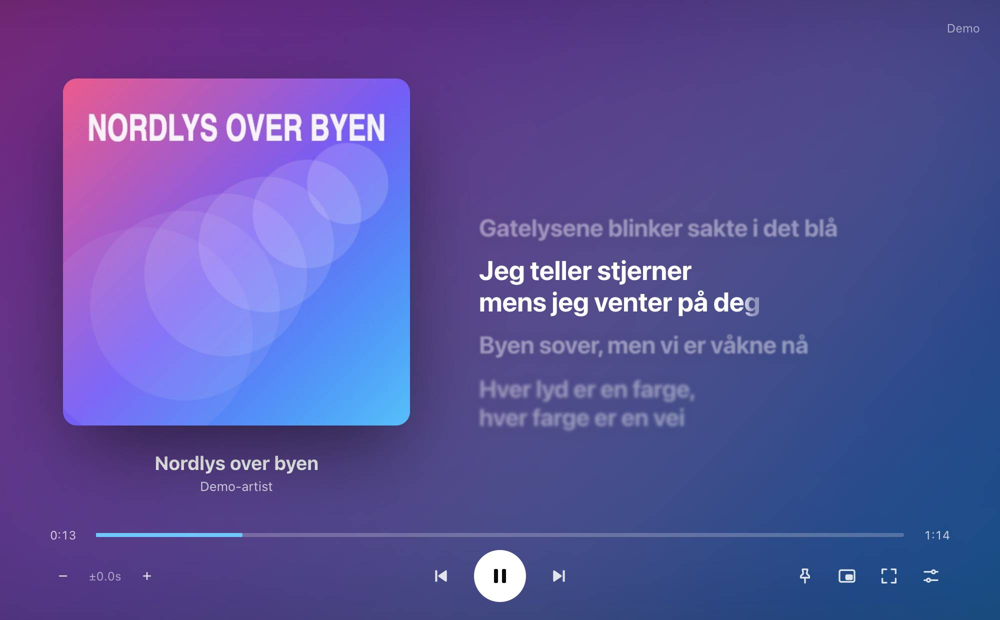
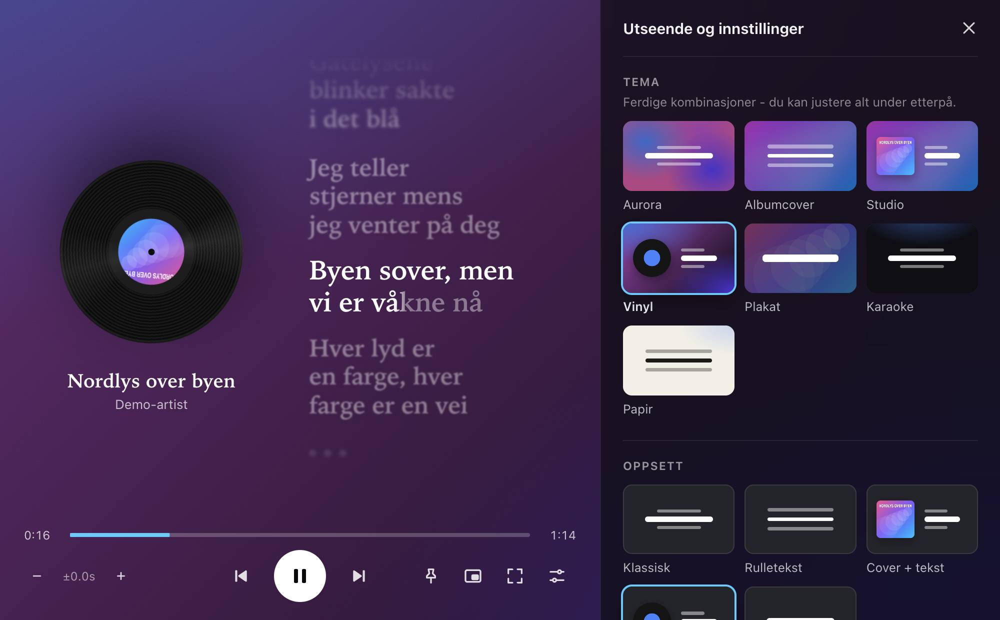

# Lyric Player

A desktop app for **Windows and macOS** that shows time-synced lyrics for whatever is playing on Spotify, line by line, in real time. You can pick from several looks.



## Features

### Looks
Choose a look from the settings panel (`S`). Changes show up live while the panel is open.

| Theme | What it looks like |
|---|---|
| **Aurora** | Animated gradient built from the album cover's colors (the original look) |
| **Albumcover** | Blurred, slowly drifting album cover in the background with scrolling lyrics |
| **Studio** | Large album cover on the left, lyrics on the right |
| **Vinyl** | A spinning record with the cover as its label, plus a serif font |
| **Plakat** | One line at a time in big uppercase letters over the full cover |
| **Karaoke** | Dark background with a rounded font and a glowing line that fills up |
| **Papir** | Light paper background, dark serif text and film grain |

Every theme is a starting point. You can mix them yourself:

- **Layout:** Classic (3 lines), Scrolling text, Cover + text, Vinyl, One line
- **Background:** Aurora, Blurred cover, Large cover, Gradient, Dark, Paper, plus sliders for blur, dimming and animation speed, and a film grain toggle
- **Text:** 5 fonts (system, serif, rounded, condensed, mono), size, alignment, number of lines before/after, uppercase
- **Effects:** karaoke fill (the line fills in as it is sung), glow, blurred inactive lines, ♪ during instrumental breaks
- **Accent color:** from the cover, Spotify green or white




### Other features
- **Playback controls:** play/pause, next/previous, and a progress bar you can click to seek (requires Spotify Premium)
- **Click a line** to jump to that point in the song
- **Sync adjustment** per song (`[` / `]`), remembered for next time, plus a global offset
- **Mini player** (`M`): a small window that stays on top in the screen corner

  
- **Always on top** (`P`), window opacity, fullscreen (`F`, or double-click)
- **Global shortcut** `Ctrl/⌘ + Shift + L` to show or hide the app from anywhere
- **Start at login** (optional)
- **Better lyrics lookup:** if there is no exact match, it searches [lrclib.net](https://lrclib.net) and strips "- Remastered 2011", "(feat. …)" and similar from the title. It falls back to unsynced lyrics when no synced ones exist. Lyrics are cached on disk.
- **Demo mode:** try every look without a Spotify account
- Smooth updates: the playback position is estimated locally between Spotify requests, and the app slows down when the window is hidden
- Secure login with PKCE: no Client Secret is needed, and the token is encrypted with the OS keychain (Keychain / DPAPI)

## Installation

### Download
Build the installers yourself (see below), or run the **Build** workflow on GitHub (Actions → Build → Run workflow, or push a `v*` tag). It produces:

- **macOS:** `Lyric Player-<version>-arm64.dmg` (Apple Silicon) and `-x64.dmg` (Intel)
- **Windows:** `Lyric Player Setup <version>.exe` (installer) and a portable `.exe`

The app is not code-signed, so the first launch shows a warning:
- **macOS:** right-click the app → **Open** → **Open**. If macOS says the app is "damaged", run `xattr -cr "/Applications/Lyric Player.app"`.
- **Windows:** click **More info** → **Run anyway** in SmartScreen.

### Connect to Spotify
1. Create an app on the [Spotify Developer Dashboard](https://developer.spotify.com/dashboard)
2. Check **Web API** and add `http://127.0.0.1:8888/callback` as a **Redirect URI**
3. Open Lyric Player, paste the **Client ID** and click **Log in with Spotify**

A Client Secret is not needed. Reading playback works with a free account, but controlling playback requires Premium.

## Development

Requires Node.js 20 or newer.

```bash
npm install
npm start          # run the app in development mode
npm run dist:mac   # build .dmg/.zip for Mac (on a Mac)
npm run dist:win   # build .exe for Windows
npm run icon       # regenerate build/icon.png
```

You can put `SPOTIFY_CLIENT_ID` in a `.env` file during development (see `.env.example`).

### Structure
```
src/
  main/        Electron main process: window, Spotify login/API, lyrics lookup, settings
  preload.js   The safe bridge between the main process and the UI
  renderer/    The UI: HTML/CSS/JS, themes, settings panel, demo mode
  shared/      Default settings shared by both
legacy/        The original Python version
```

### Keyboard shortcuts
| Key | Action |
|---|---|
| `Space` | Play / pause |
| `←` / `→` | Previous / next song |
| `[` / `]` | Show lyrics later / earlier (hold `Shift` for bigger steps), `0` resets |
| `↑` / `↓` | Larger / smaller text |
| `T` / `L` / `B` | Next theme / layout / background |
| `F` | Fullscreen, `Esc` exits |
| `M` | Mini player |
| `P` | Always on top |
| `S` | Open / close settings |
| `Q` | Quit |

## Ideas for later
- Translation and romanization of lyrics (e.g. for Japanese or Korean)
- System tray / menu bar icon with the current line
- Transparent "desktop overlay" mode where the lyrics float over other windows
- Word-by-word sync (enhanced LRC) where available
- Auto-update via GitHub Releases

## License
Free for personal use. Not affiliated with or endorsed by Spotify or lrclib.net.
